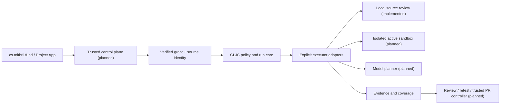

# ADR-0001: independent CLJC security engine

Date: 2026-11-13. Direction owner: Jun. Implementer: Codex/MITHRIL-2471.
Independent reviewer and production publisher: UNKNOWN.
Status: adopted initial source architecture; not a deployed autonomous service.

## Decision and workload

Use an independent `mithril-lang/mithril-cs` repository. Keep deterministic policy, run state and rules in CLJC, JVM/Babashka filesystem adapters in CLJ. This implements Jun's current CLJC direction for this engine. It does not migrate the Fund TypeScript/Python implementation.

First workload: one caller-owned quiescent local source tree, 250 files, 4 MiB, one review step, no model calls/network/target execution. Core states are ready/running/completed/incomplete/denied/cancelled. Every admitted step checks scope, revocation, expiration, monotonic caller clock and budget. Completed means the configured lexical scope was processed, not vulnerability clearance. Evidence records bind run, target, source hash, rule and location. Candidates stay needs-review.

The current local acknowledgement/grant is not a signed service authorization. A trusted future controller must create verified grants and enforce tenant/project/epoch at the actual side-effect boundary. This pure state machine is neither a distributed lease nor a security sandbox. Parallel writers, durable resume/deduplication, active cancellation during blocking I/O and hard process deadlines are not implemented.

## Architecture

### Boundaries

- No target input or model response may widen scope, grant authority, select credentials or mark an exploit confirmed.
- Models may propose typed actions; the controller checks capability/scope/budget before each adapter call.
- Active executors require tenant/run/epoch binding, deny-default network egress, current DNS/IP/redirect checks, test identities, process isolation, resource/time limits and revocation/cancellation. No such executor is shipped here yet.
- Findings require trusted reproduction evidence before confirmation. Synthetic executor success cannot qualify a live exploit.
- Patches bind base/head/source/evidence/diff digest. Retest, human review and scoped publication authority precede PR creation. Never auto-merge or deploy.
- Future evidence transport uses existing qualified private destinations and catalog manifests; no reports/logs in Git or GitHub artifacts. Report stdout is ephemeral caller output, not durable custody.

## Fund integration

Existing MITHRIL-2203 CLI/evidence contract remains the integration owner. This v1 local EDN report is **not** a drop-in replacement for Fund's signed/authenticated receipts. Add a versioned translation adapter with golden positive/negative fixtures for tenant/project/repository/commit/base/head/config/run binding; preserve incomplete, skipped, denied and unknown states. Do not expose this CLI directly as a hosted scanner.

Source files in this bootstrap have exact byte hashes; no Git-revision coherence is claimed for a concurrently changing tree. Fund commit-object scanning is preferable for PR review and must retain its immutable-source and authorization checks. Do not import private Fund code into this public repository. No cross-org services or package modules are introduced.

## Alternatives and reconsideration

1. Extend Fund's current Python scanner: lowest integration risk, but does not satisfy the requested independent CLJC engine.
2. Fork Strix: provides a much larger Python stack, but does not satisfy the language direction and carries a different operational/tool trust boundary.
3. Independent CLJC core with explicit adapters (chosen): portable deterministic logic and small credential-free starting surface; significant sandbox/model/integration work remains.

CLJS is a declared validation target, not established portability until its suite executes. No kotoba/amu compatibility is inferred from the .cljc extension.

Review immediately after an isolation, stale-owner, data-loss or duplicate-side-effect failure; revisit on changed workload/trust boundary/toolchain support. Measure at least three comparable windows before interpreting noisy performance regressions. Pre-measurement triggers: 80% of current file/byte limits, p95 time or cost 20% above an established comparable baseline, or forecast exhaustion within 90 days. These are review triggers, not SLOs. No production baseline exists: p50/p95/p99, concurrency, cost, operator hours and capacity remain UNKNOWN. Initial bounded measurement plan: exact-source JVM/BB/CLJS suites, then 3 x 20 synthetic 250-file/4-MiB runs on the same qualified VKE image, collecting resource/runtime aggregates in the approved private store.

## Transition / reversibility

No live owner, service, datastore, grant authority or traffic changes. Existing Python engine and Fund integration remain active under their current owners. A future service cutover requires source-bound translation verification, one authority per stage, fencing/unknown-outcome recovery tests, source/evidence integrity read-back and rollback. Keep this initial adapter independently removable.

## Controlled assessment and repair extension

A deterministic CLJC planner now executes four typed probes against the bundled, in-process synthetic IDOR target: owner, cross-tenant actor, anonymous actor and absent-object negative control. Every probe passes the grant/revocation/cancellation/budget gate. The fixture source SHA256 and revision bind all evidence; only successful controls plus actual foreign-object disclosure yield reproduced-in-controlled-fixture evidence. No sockets, arbitrary target or model tools are admitted.

Auto-Fix proposes the exact synthetic configuration change, binds before/after digests, base revision, target and reproduced evidence, requires a review bound to the entire proposal, and applies only to a new in-memory fixture. The same assessment reruns against the patched digest. No file, PR, merge or deployment operation exists. Test reviewer identities are synthetic fixtures, not verified human/service identities. Live signed review, Git immutable-source acquisition, privileged patch publication and executor containment remain separate gates.
